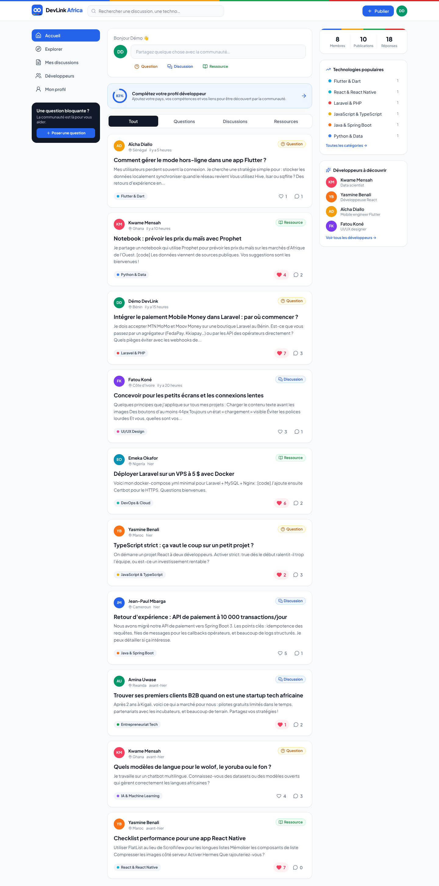

# DevLink Africa

[](https://github.com/orouabdoul/devlink-africa/actions/workflows/tests.yml)

**Connect. Share. Build together.**

La plateforme communautaire qui connecte les développeurs africains autour du partage de connaissances, de la résolution de problèmes techniques et de la collaboration. Projet présenté à la **CADEV 2026**.



> Notre promesse : ne plus perdre les bonnes réponses techniques dans des centaines de messages WhatsApp.

## Fonctionnalités du MVP

| Module | Ce qui fonctionne |
|---|---|
| Authentification | Inscription, connexion, déconnexion, mot de passe oublié (Laravel Breeze) |
| Profil développeur | Photo, titre, pays (54 pays africains + diaspora), présentation, compétences, GitHub, LinkedIn |
| Discussions | Créer, consulter, modifier, supprimer ses publications — types Question / Discussion / Ressource |
| Contenu | Markdown sécurisé (blocs de code, listes, liens) — HTML brut et liens `javascript:` supprimés |
| Réponses | Répondre, modifier et supprimer ses propres réponses |
| Catégories | 10 technologies (Flutter, React, Laravel, JS/TS, Java, Python, IA, UI/UX, DevOps, Entrepreneuriat) |
| Explorer | Filtre par catégorie et par type, tri : récentes / populaires / sans réponse |
| Recherche | Par mots-clés dans les titres et contenus, plus les développeurs (nom, compétence, pays) |
| J'aime | Aimer / retirer son like (contrainte unique en base) |
| Développeurs | Annuaire filtrable par pays et compétence, page profil publique avec statistiques |
| Tableau de bord | Fil d'actualité, statistiques, technologies populaires, développeurs à découvrir, complétion du profil |
| Sécurité | Policies Laravel (seul l'auteur modifie/supprime), validation serveur, limitation de débit sur publications/réponses/likes |
| Responsive | Menu latéral sur ordinateur, barre de navigation en bas + bouton flottant sur mobile |
| Captures d'écran | Jusqu'à 4 images par publication et 2 par réponse : bouton, glisser-déposer ou **Ctrl+V** ; réduites automatiquement, agrandissables au clic |
| Documents | Jusqu'à 3 documents par publication et 1 par réponse (PDF, Word, Excel, PowerPoint, OpenDocument, TXT, Markdown, CSV, JSON, logs ; 5 Mo) : stockés hors du dossier public, réservés aux membres, PDF lisibles dans le navigateur |
| Traduire | Bouton « Traduire » sur chaque publication et réponse : traduction intégrée de Chrome (le code reste intact), sinon Google Traduction |
| Outils pour le code | Bouton « Insérer du code » avec choix du langage, bloc d'erreur, coloration syntaxique, bouton **Copier** sur chaque bloc |
| Aide aux questions | Modèle « question d'erreur » (contexte, erreur, essais, environnement) et alerte si un mot de passe ou une clé secrète est collé, avec masquage automatique |
| Langues | Interface en français (par défaut) et en anglais, sélecteur FR / EN dans l'en-tête ; messages d'erreur traduits |

## Stack

Laravel 12 · PHP 8.2+ · Vue 3 · Inertia.js 2 · Tailwind CSS · MySQL (ou SQLite en local) · Vite · Lucide

> Laravel 12 plutôt que 11 : la branche 11 ne reçoit plus de correctifs de sécurité. Le code et la structure sont identiques à ce qui était prévu.

## Installation locale

Prérequis : PHP 8.2+, Composer, Node.js 20+, MySQL 8 (ou SQLite).

```bash
composer install
npm install
cp .env.example .env
php artisan key:generate
```

Configurez la base dans `.env` :

```env
DB_CONNECTION=mysql
DB_HOST=127.0.0.1
DB_PORT=3306
DB_DATABASE=devlink_africa
DB_USERNAME=root
DB_PASSWORD=
```

Puis :

```bash
php artisan migrate --seed     # tables + catégories + données de démonstration
php artisan storage:link       # nécessaire pour les photos de profil
npm run build                  # ou « npm run dev » pendant le développement
php artisan serve
```

Ouvrez http://127.0.0.1:8000

### Comptes de démonstration

Tous les comptes de démo ont le mot de passe **`DevLink2026`** :

- `demo@devlink.africa` (compte principal à donner au jury)
- `aicha@devlink.africa`, `kwame@devlink.africa`, `fatou@devlink.africa`, `emeka@devlink.africa`…

Avec `DEVLINK_SHOW_DEMO=true` dans `.env`, la page de connexion affiche un bouton qui remplit automatiquement le compte démo. Mettez `false` après le concours.

### Tests

```bash
php artisan test
```

68 tests automatisés couvrent la checklist de soumission (inscription, profil, publication, catégories, commentaires, likes, autorisations, recherche, sécurité du Markdown, changement de langue, captures d'écran, documents).

## Mise en ligne sur alwaysdata (offre gratuite, HTTPS inclus)

1. Créez un compte sur alwaysdata.com (offre *Free*). Le nom du compte donne l'adresse du site : `https://<compte>.alwaysdata.net`.
2. **Bases de données > MySQL** : créez une base (ex. `<compte>_devlink`) et notez le mot de passe de l'utilisateur MySQL.
3. **Accès distant > SSH** : modifiez l'utilisateur et cochez la connexion par mot de passe.
4. Envoyez l'archive prête à déployer : `scp devlink-africa-alwaysdata.zip <compte>@ssh-<compte>.alwaysdata.net:~/`
5. Connectez-vous (`ssh <compte>@ssh-<compte>.alwaysdata.net` ou https://ssh-<compte>.alwaysdata.net), puis :
   ```bash
   unzip devlink-africa-alwaysdata.zip
   bash devlink-africa/deploy/alwaysdata.sh
   ```
   Le script vérifie PHP, crée le `.env`, la base, les données de démo et les caches.

   **Mises à jour suivantes** : envoyez l'archive de mise à jour avec `scp`, puis `unzip -o devlink-africa-mise-a-jour.zip && bash devlink-africa/deploy/update.sh`.
6. **Web > Sites** : modifiez le site, type PHP (8.3), répertoire racine `/devlink-africa/public/`.

## Autre option : mise en ligne (hébergement mutualisé type cPanel)

1. **Base de données** : dans cPanel → *Bases de données MySQL*, créez une base, un utilisateur, et donnez-lui tous les droits.
2. **Fichiers** : envoyez l'archive *prête à déployer* (elle contient déjà `vendor/` et `public/build/`) dans un dossier **hors** de `public_html`, par exemple `~/devlink-africa`.
3. **Dossier public** : faites pointer le domaine (ou sous-domaine) vers `~/devlink-africa/public`.
   Si l'hébergeur l'interdit, copiez le contenu de `public/` dans `public_html/` et modifiez `public_html/index.php` pour remplacer `__DIR__.'/../` par `__DIR__.'/../devlink-africa/`.
4. **Fichier `.env`** : copiez `.env.example` en `.env` et réglez :
   ```env
   APP_ENV=production
   APP_DEBUG=false
   APP_URL=https://votre-domaine
   DB_CONNECTION=mysql
   DB_DATABASE=...  DB_USERNAME=...  DB_PASSWORD=...
   DEVLINK_SHOW_DEMO=true
   ```
5. **Commandes** (Terminal cPanel ou SSH) :
   ```bash
   php artisan key:generate --force
   php artisan migrate --seed --force
   php artisan storage:link
   php artisan config:cache && php artisan route:cache && php artisan view:cache
   ```
   Sans terminal : demandez à l'hébergeur d'exécuter ces commandes, ou importez la base depuis votre machine via phpMyAdmin.
6. **HTTPS** : activez le certificat gratuit (AutoSSL / Let's Encrypt) dans cPanel.
7. **Droits** : `storage/` et `bootstrap/cache/` doivent être accessibles en écriture (755 ou 775).
8. Vérifiez la version PHP dans cPanel : **8.2 minimum**, avec les extensions `pdo_mysql`, `mbstring`, `fileinfo`, `openssl`.

## Architecture

```
app/
├── Http/Controllers/   FeedController, ExploreController, PostController, CommentController,
│                       LikeController, SearchController, DeveloperController, DeveloperProfileController
├── Http/Requests/      StorePostRequest, StoreCommentRequest, UpdateDeveloperProfileRequest
├── Models/             User, Profile, Category, Post, Comment, Like
└── Policies/           PostPolicy, CommentPolicy
database/
├── migrations/         profiles, categories, posts, comments, likes
└── seeders/            CategorySeeder, DemoSeeder
resources/js/
├── Components/         PostCard, CommentCard, LikeButton, CategoryBadge, TypeBadge, UserAvatar, PostForm…
├── Layouts/            AuthenticatedLayout (en-tête, menu, colonne droite, nav mobile), GuestLayout
└── Pages/              Welcome, Dashboard, Explore, Search, Posts/*, Developers/*, Profile/Edit, Auth/*
```

### Base de données

- `users` 1—1 `profiles` (unique `user_id`, créé automatiquement à l'inscription)
- `users` 1—n `posts` n—1 `categories`
- `posts` 1—n `comments`, `posts` 1—n `likes` (unique `user_id, post_id`)
- Suppressions en cascade : supprimer un compte supprime ses publications, réponses et likes.

### Routes principales

| Méthode | URL | Rôle |
|---|---|---|
| GET | `/dashboard` | Fil d'actualité |
| GET | `/explore` | Explorer par catégorie / type / tri |
| GET | `/search?q=` | Recherche |
| GET | `/my-posts` | Mes discussions |
| GET/POST | `/posts/create`, `/posts` | Créer une publication |
| GET/PUT/DELETE | `/posts/{post}` | Consulter / modifier / supprimer |
| POST | `/posts/{post}/comments` | Répondre |
| PUT/DELETE | `/comments/{comment}` | Modifier / supprimer sa réponse |
| POST | `/posts/{post}/like` | Aimer / retirer le like |
| GET | `/developers`, `/developers/{user}` | Annuaire et profil public |
| GET | `/profile` · POST `/profile/developer` | Modifier son compte et son profil développeur |

## Après le concours (hors MVP)

Autres langues (portugais, arabe, swahili), messagerie privée, notifications, chat temps réel, recrutement, assistant IA, application mobile, marquage d'une « meilleure réponse », favoris.
